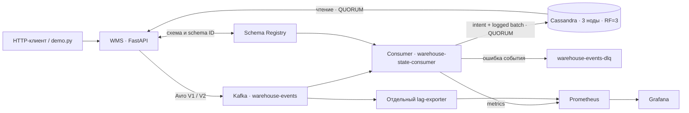

# Smart Warehouse

Домашнее задание №6: склад, состояние которого меняется по событиям из Kafka. Реализованы все восемь видов операций, хранение в Cassandra, повторная обработка без удвоения остатков, DLQ, кластер из трёх нод и мониторинг.

Основной разбор находится в [отчёте](docs/REPORT.md). Для защиты есть [сценарий демонстрации](docs/DEMO.md), автоматический прогон и [готовые HTTP-запросы](examples/requests.http).

## Запуск

Нужны Docker Engine с Docker Compose и примерно 8 ГБ свободной памяти. Python 3 на компьютере нужен только для запуска демонстрационного скрипта. Само приложение работает в контейнерах.

```bash
cd /home/gsluzh/soa-hw6
docker compose up -d --build
```

Можно запустить и обычным `docker compose up` — сборка выполнится при отсутствии образа. В старой версии Compose команда называется `docker-compose up`.

Первый запуск дольше последующих: Cassandra последовательно поднимает ноды, затем `init` создаёт топики, регистрирует схемы, применяет миграции и добавляет зоны `ZONE-A`, `ZONE-B`, `ZONE-C`. При повторном запуске данные сохраняются. Успешное завершение `init` с кодом 0 — нормальное состояние этого контейнера.

```bash
docker compose ps
docker compose logs init
curl http://localhost:8001/health
```

| Адрес | Что открывается |
|---|---|
| http://localhost:8080/docs | Swagger WMS: отправка событий и чтение склада |
| http://localhost:8001/health | Готовность consumer, Kafka и Cassandra |
| http://localhost:8001/metrics | Метрики consumer |
| http://localhost:8002/metrics | Lag, даже когда consumer остановлен |
| http://localhost:8081/subjects | Schema Registry |
| http://localhost:9090 | Prometheus, запросы и Alerts |
| http://localhost:3000/d/smart-warehouse | Grafana, логин `admin`, пароль `warehouse-demo` |

## Короткая проверка

```bash
curl -sS -X POST 'http://localhost:8080/events?schema_version=2' \
  -H 'Content-Type: application/json' \
  -d '{"event_type":"PRODUCT_RECEIVED","product_id":"SKU-001","zone_id":"ZONE-A","quantity":100,"supplier_id":"SUP-001"}'

curl -sS http://localhost:8080/inventory/products/SKU-001
```

`POST /events` возвращает HTTP 202, `event_id`, партицию и offset. Это подтверждение записи в Kafka. Обработка асинхронная: её результат можно проверить через `GET /events/{event_id}`. Появление статуса `APPLIED` означает, что запись в Cassandra подтверждена. `outcome=STALE` означает, что событие запомнили, но остатки не меняли. Ошибки предметной области попадают в DLQ.

Для автоматической демонстрации:

```bash
python3 scripts/demo.py          # склад, дубли, три проекции, порядок, DLQ, V1/V2
python3 scripts/demo.py --full   # плюс отказ ноды, lag, алерт и авария перед commit
```

Сохранённый показ: [текстовый протокол](artifacts/demo-full.txt) и [терминальная запись](artifacts/demo.cast).

Полный вариант временно останавливает `cassandra-2` и consumer, затем запускает их обратно. Каждый прогон использует новые SKU, поэтому удалять данные между демонстрациями не нужно.

```bash
make test                       # тесты правил склада и протокола обработки
make logs                       # логи consumer
make down                       # остановка с сохранением данных
```

## Как устроена система



Это один склад с одним последовательным обработчиком и одной партицией. Такой выбор позволяет резервировать заказ с несколькими SKU без гонки между разными consumer. Ключ сообщений — `warehouse-main`. Увеличивать число партиций или запускать независимые обработчики поверх этих же таблиц без изменения протокола нельзя. В отчёте объяснено, как можно масштабировать решение по независимым складам.

## Модель Cassandra и запросы

Таблицы соответствуют конкретным способам чтения. JOIN, `ALLOW FILTERING` и Cassandra counters не используются.

| Таблица | Partition key | Clustering key | Назначение |
|---|---|---|---|
| `inventory_by_product_zone` | `product_id` | `zone_id` | Одна зона товара или все его зоны |
| `inventory_by_product` | `product_id` | — | Готовые суммы доступного и зарезервированного |
| `inventory_by_zone` | `zone_id` | `product_id` | Все товары в зоне |
| `orders` | `order_id` | — | Статус и позиции заказа |
| `zones` | `zone_id` | — | Вместимость и занятое количество |
| `processed_events` | `event_id` | — | Дедупликация и сохранённый план записи |
| `event_history` | `event_day` | `event_id` | Аудит за день UTC |
| `runtime_state` | `name` | — | Монотонная метка физических записей |
| `schema_migrations` | `version` | — | Применённые миграции |

`product_id` здесь одновременно является SKU. Партиция по товару позволяет читать его зоны одним запросом, а обратная проекция по зоне нужна для обхода полки. Суммы вынесены отдельно: клиенту не приходится пересчитывать их при каждом запросе. История разделена по дням, чтобы не собирать весь аудит в одной вечной партиции.

```sql
-- В cqlsh:
CONSISTENCY QUORUM;
USE warehouse;

-- Конкретная ячейка товара.
SELECT * FROM inventory_by_product_zone
WHERE product_id = 'SKU-001' AND zone_id = 'ZONE-A';

-- Все зоны товара.
SELECT * FROM inventory_by_product_zone WHERE product_id = 'SKU-001';

-- Агрегат по всем зонам.
SELECT * FROM inventory_by_product WHERE product_id = 'SKU-001';

-- Содержимое зоны.
SELECT * FROM inventory_by_zone WHERE zone_id = 'ZONE-A';
```

Открыть консоль: `docker exec -it cassandra-1 cqlsh`.

Чтение и запись выполняются с `QUORUM`: при RF=3 нужны две реплики. Здесь чтение участвует в расчёте следующего остатка, поэтому `ONE` может дать устаревшее число. При одной выключенной ноде обе операции продолжают работать. Для начального сохранения плана используется LWT `IF NOT EXISTS` с `SERIAL` и подтверждением `QUORUM`.

## Что происходит при сбоях

Автокоммит и автоматическое сохранение offset выключены. Consumer сначала рассчитывает изменения, сохраняет план по `event_id`, применяет абсолютные значения одним logged batch и только после этого синхронно подтверждает Kafka. Повтор использует тот же план и те же Cassandra timestamps. Это закрывает окно между записью данных и commit.

У Cassandra logged batch гарантирует завершение всех мутаций, но не даёт изоляцию нескольких партиций для параллельного читателя. Поэтому API не обещает транзакционный снимок во время записи. После успешного batch и до следующего события три проекции согласованы. Это ограничение самой модели Cassandra, а не повод объявлять её SQL-транзакцией.

Устаревшие события отбрасываются по времени сущности. Для нескольких товаров проверяются все затронутые товары; отклоняется целое событие. Одинаковое время также считается устаревшим. Этот подход соответствует условию задания; он не восстанавливает потерянную бизнес-операцию автоматически.

Ошибочное событие отправляется в DLQ с полным исходным содержимым и сырыми байтами. При недоступности Cassandra или Schema Registry consumer переподключается и не подтверждает offset. Повтор в DLQ возможен при аварии после публикации и до commit: ключ `topic:partition:offset` позволяет его распознать.

## Эволюция схемы

Subject — `warehouse-events-value`, совместимость — `BACKWARD`. В V2 добавлен `supplier_id` с типом `["null", "string"]` и `default: null`. Consumer получает writer schema по идентификатору в сообщении, читает данные новой схемой и явно различает V1/V2. Старые события получают `supplier_id=null`. Новые сохраняют поставщика в обеих зональных проекциях и истории.

Чтобы добавить следующую версию:

1. Скопировать актуальный `.avsc`, сохранить полное имя record, добавить поле с подходящим значением по умолчанию.
2. Проверить схему через `POST /compatibility/subjects/warehouse-events-value/versions/latest`.
3. Добавить миграцию Cassandra и обработку новой версии в consumer, проверить чтение старых сообщений.
4. Зарегистрировать схему через `POST /subjects/warehouse-events-value/versions`.
5. Обновить producer после consumer. Для третьей версии расширить список поддерживаемых версий в `codec.py` и тесты.

Точные команды и объяснение совместимости приведены в [пункте 10 отчёта](docs/REPORT.md#10-эволюция-avro-схемы).

## Состав проекта

```text
warehouse/       WMS, consumer, правила склада, Cassandra, Avro, lag-exporter
schemas/         Avro V1 и V2
migrations/      базовая модель и добавление supplier_id
monitoring/      Prometheus, алерты, provisioning Grafana и дашборд
scripts/         демонстрация и чтение DLQ
tests/           правила предметной области, восстановление, commit, Avro
examples/        готовые HTTP-запросы
docs/            отчёт и руководство к демонстрации
artifacts/       результаты выполненных проверок
```

Подробности гарантий сверены с документацией [Cassandra BATCH](https://cassandra.apache.org/doc/latest/cassandra/developing/cql/dml.html#batch), [Kafka Python Consumer](https://docs.confluent.io/kafka-clients/python/current/index.html) и [Schema Registry compatibility](https://docs.confluent.io/platform/current/schema-registry/fundamentals/schema-evolution.html).
