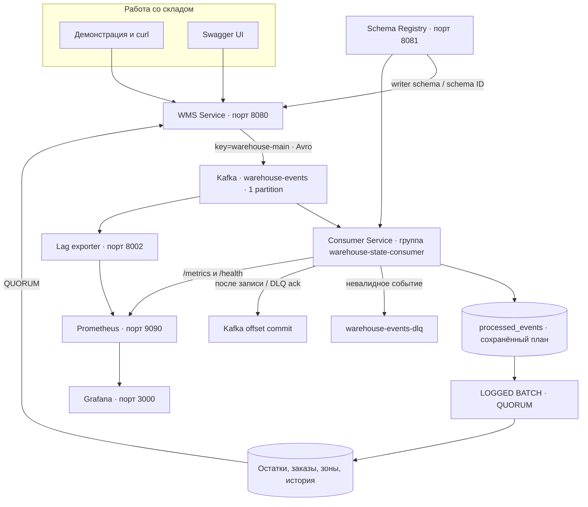
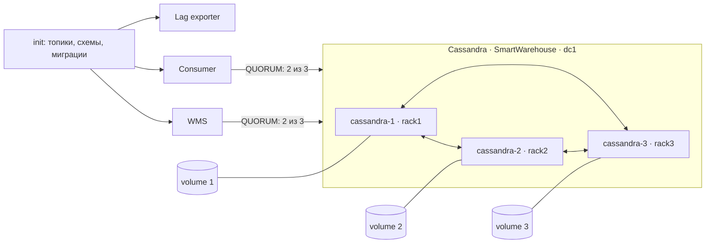
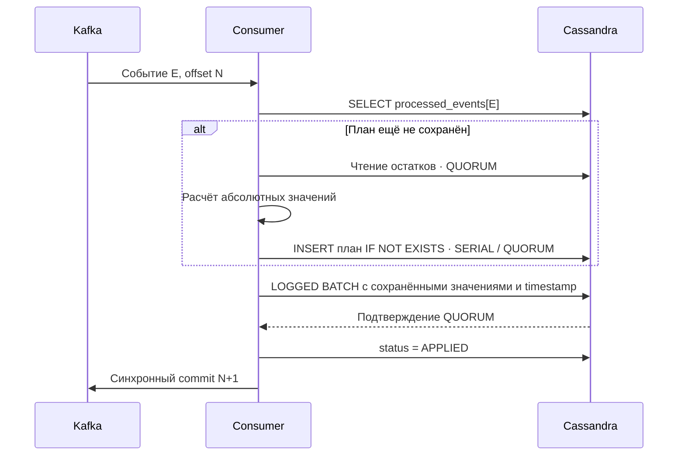

# Отчёт по домашнему заданию №6

## Smart Warehouse: управление состоянием склада через события

В этой работе склад представлен как поток операций. WMS принимает команду на приёмку, перемещение или отгрузку и публикует событие в Kafka. Отдельный consumer последовательно применяет события к Cassandra. Благодаря этому перезапуск WMS не влияет на уже опубликованные операции, а перезапуск consumer не удаляет остатки.

Реализация написана на Python 3.11. HTTP API работает на FastAPI, клиент Kafka — `confluent-kafka`, сериализация — Avro через `fastavro`, база — Cassandra 4.1.7. В Compose также входят Kafka 7.9.0 из Confluent Platform, Schema Registry, Prometheus и Grafana. Номера образов и Python-зависимостей зафиксированы, чтобы повторный запуск не зависел от содержимого тега `latest`.

## Архитектура приложения



WMS и consumer не разделяют память и не вызывают друг друга напрямую. Ответ `202 Accepted` от WMS означает, что Kafka подтвердила публикацию. Остаток изменяется позже, когда consumer обработает сообщение. Для проверки завершения есть `GET /events/{event_id}`.

Здесь один логический склад, одна партиция `warehouse-events` и один активный обработчик. Это осознанное ограничение. Если разделить сообщения только по SKU, заказ из нескольких товаров может одновременно попасть к нескольким обработчикам. Тогда обычное чтение остатка с последующей записью не защитит от потерянного обновления. В данной модели все операции склада упорядочены Kafka, в том числе операции над разными товарами одной зоны.

Для масштабирования естественная граница — независимый склад. Можно добавить `warehouse_id` в ключи таблиц и событий и распределять склады по партициям. Перемещение между складами тогда станет отдельным протоколом, например с резервированием и подтверждением обеих сторон. Простого увеличения числа партиций в текущем проекте недостаточно.

## Архитектура развёртывания



Каждая нода Cassandra имеет собственный том. Kafka, Prometheus и Grafana также сохраняют данные в именованных томах. `docker compose down` удаляет контейнеры и сеть, но оставляет эти данные. Команда с `-v` удаляет и тома — для обычной демонстрации она не нужна.

Ноды Cassandra запускаются последовательно, чтобы первоначальное присоединение к кластеру не происходило одновременно. После healthcheck всех зависимостей запускается `init`. Основные сервисы стартуют только после его успешного завершения. Миграция `001_initial.cql` создаёт таблицы, `002_supplier.cql` добавляет новое поле поставщика. Применённые версии фиксируются в `schema_migrations`. Повторная инициализация не обнуляет остатки и вместимость зон.

## 1. Kafka consumer и семантика доставки

Consumer читает `warehouse-events` в группе `warehouse-state-consumer`. Два параметра явно выключены:

```python
'enable.auto.commit': False,
'enable.auto.offset.store': False,
```

После успешной обработки вызывается:

```python
client.commit(message=message, asynchronous=False)
```

При обработке сообщения с offset 17 Kafka сохраняет 18 — позицию следующего сообщения. Consumer не переходит к обработке следующего сообщения, пока текущий вызов обработки и commit не завершатся.

Порядок работы такой:

1. Прочитать и декодировать событие.
2. Проверить `event_id` и получить сохранённый план либо рассчитать новый.
3. Записать изменения в Cassandra и дождаться подтверждения.
4. Синхронно подтвердить offset в Kafka.
5. Записать результат в лог.

Если процесс завершится между третьим и четвёртым шагом, Kafka доставит событие повторно. Поэтому семантика доставки — **at-least-once**. Корректный результат при повторной доставке обеспечивает слой идемпотентности, описанный в пункте 4. Транзакции Kafka и Cassandra здесь нет.

После рестарта consumer присоединяется к той же группе и продолжает с последней сохранённой позиции. `auto.offset.reset=earliest` используется лишь тогда, когда сохранённой позиции нет или она уже недоступна.

Лог содержит `event_id`, `event_type`, `partition`, `offset`, `outcome` и `schema_version`. Для проверки достаточно:

```bash
docker compose logs -f consumer
```

В коде это `warehouse/consumer.py`, функция `handle`. Правило ручного подтверждения соответствует [документации Confluent Python Client](https://docs.confluent.io/kafka-clients/python/current/index.html).

## 2. Модель данных Cassandra

Модель начинается с запросов пользователя склада. Нужны остаток товара в ячейке, все ячейки товара, итог по товару, содержимое зоны и состояние заказа. Под эти запросы сделаны отдельные таблицы.

| Таблица | Ключ партиции | Ключ кластеризации | Почему так |
|---|---|---|---|
| `inventory_by_product_zone` | `product_id` | `zone_id` | Все зоны одного товара лежат рядом; можно выбрать одну зону |
| `inventory_by_product` | `product_id` | отсутствует | Одна готовая строка итогов по SKU |
| `inventory_by_zone` | `zone_id` | `product_id` | Можно прочитать содержимое зоны без поиска по всем товарам |
| `orders` | `order_id` | отсутствует | Заказ читается целиком по номеру |
| `zones` | `zone_id` | отсутствует | Вместимость и занятость зоны читаются по её идентификатору |
| `processed_events` | `event_id` | отсутствует | Точечная проверка повтора и восстановление операции |
| `event_history` | `event_day` | `event_id` | История разделена по дням UTC |
| `runtime_state` | `name` | отсутствует | Последняя физическая метка записи одного обработчика |
| `schema_migrations` | `version` | отсутствует | Проверка, применялась ли конкретная миграция |

Одна строка зональной проекции содержит `available_quantity`, `reserved_quantity`, `manual_reserved_quantity`, `last_event_at`, `last_event_id`, `supplier_id`. Ручной резерв хранится отдельно внутри общего резерва: операция снятия ручного резерва не должна забирать товар, уже обещанный заказу.

`inventory_by_product` хранит `total_available` и `total_reserved`. Это именно агрегат. Перечень зон находится в `inventory_by_product_zone`. Две таблицы имеют похожие названия, но обслуживают разные запросы.

Позиции заказа записаны в `items_json`. Заказ читается целиком, а количество позиций ограничено десятью. При такой форме доступа отдельная таблица позиций не даёт преимущества и только усложняет восстановление заказа. Товар в этой работе идентифицируется SKU; отдельного каталога названий и цен нет.

Примеры запросов:

```sql
CONSISTENCY QUORUM;
USE warehouse;

SELECT available_quantity, reserved_quantity, supplier_id
FROM inventory_by_product_zone
WHERE product_id = 'SKU-001' AND zone_id = 'ZONE-A';

SELECT zone_id, available_quantity, reserved_quantity
FROM inventory_by_product_zone WHERE product_id = 'SKU-001';

SELECT total_available, total_reserved
FROM inventory_by_product WHERE product_id = 'SKU-001';

SELECT product_id, available_quantity, reserved_quantity
FROM inventory_by_zone WHERE zone_id = 'ZONE-A';

SELECT status, items_json FROM orders WHERE order_id = 'ORDER-001';
SELECT capacity, occupied FROM zones WHERE zone_id = 'ZONE-A';

SELECT event_id, event_type, outcome, payload_json
FROM event_history WHERE event_day = '2026-04-01';

SELECT status, outcome, source_offset
FROM processed_events WHERE event_id = 'receive-001';
```

В рабочих запросах нет JOIN, полного сканирования таблиц и `ALLOW FILTERING`. Цена быстрых чтений — несколько копий части данных и более сложная запись. История за день упорядочена по `event_id`, а не по времени события. Для временного диапазона внутри дня потребовалась бы ещё одна проекция с временным clustering key. При большом потоке дневную партицию истории также стоит разделить на часовые или на несколько сегментов.

## 3. Изменение состояния по событиям

Правила находятся в `warehouse/domain.py`. Функция `transition` получает событие и прочитанный снимок состояния, возвращает новые значения строк и не выполняет внешних запросов. Это делает правила проверяемыми отдельно от инфраструктуры.

| Событие | Изменение |
|---|---|
| `PRODUCT_RECEIVED` | Прибавить количество к доступному остатку зоны |
| `PRODUCT_SHIPPED` | Вычесть количество из доступного остатка зоны |
| `PRODUCT_MOVED` | Вычесть доступное количество из исходной зоны и прибавить в целевую |
| `PRODUCT_RESERVED` | Перенести доступное количество в общий и ручной резерв |
| `PRODUCT_RELEASED` | Вернуть ручной резерв в доступный остаток |
| `INVENTORY_COUNTED` | Установить доступный остаток в `counted_quantity`; резерв сохранить |
| `ORDER_CREATED` | Создать заказ `CREATED` и зарезервировать все его позиции |
| `ORDER_COMPLETED` | Установить `COMPLETED` и отгрузить резерв заказа; доступный остаток не менять |

Для количества в обычной операции разрешены целые значения от 1 до 1 000 000. Пересчёт допускает ноль. Проверяются наличие зоны, достаточность остатков, вместимость и допустимый статус заказа. `occupied` — сумма доступного и зарезервированного товара всех SKU в зоне. Резервирование не меняет занятое место, а отгрузка уменьшает его.

Если в заказе не хватает хотя бы одной позиции, изменения не записываются ни по одной из позиций. Перемещение в ту же зону запрещено. В заказе нельзя повторить одну пару `(product_id, zone_id)`. Повторное завершение заказа с новым `event_id` не списывает товар ещё раз: оно отклоняется проверкой статуса либо правилом устаревания.

Пример базового цикла:

| Шаг | Зона A: доступно | Зона A: резерв | Зона B: доступно |
|---|---:|---:|---:|
| Приёмка 100 | 100 | 0 | 0 |
| Ручной резерв 30 | 70 | 30 | 0 |
| Перемещение 20 в B | 50 | 30 | 20 |
| Отгрузка 10 из A | 40 | 30 | 20 |
| Создание заказа на 15 | 25 | 45 | 20 |
| Завершение заказа | 25 | 30 | 20 |

У заказа товар вычитается из доступного количества в момент резервирования. При завершении повторно вычитать его из `available` нельзя.

Состояние целиком находится в Cassandra. Память Python-процесса содержит только временные объекты и кэш подготовленных запросов. Перезапуск процесса не сбрасывает склад.

## 4. Идемпотентность и восстановление

Одной проверки «есть ли `event_id` в таблице» недостаточно. Если сначала изменить остаток, а затем записать маркер обработки, авария между этими действиями приведёт к повторному прибавлению. Если сначала записать маркер и затем менять остаток, авария может привести к пропуску операции.

Поэтому перед изменением состояния сохраняется **план записи**. В нём находятся абсолютные значения всех затронутых строк, исходное событие, позиция Kafka и фиксированный Cassandra timestamp. План создаётся через `INSERT ... IF NOT EXISTS` в `processed_events`.



Например, было 20 единиц, событие добавляет 50. В плане сохраняется 70. После неизвестного результата записи повтор записывает 70 ещё раз, а не вычисляет `70 + 50`. Cassandra timestamps тоже повторяются: поздний повтор старого плана не должен перезаписать более новое состояние.

Физическая метка записи вычисляется как максимум текущего времени в микросекундах и предыдущей метки плюс один. Она не равна бизнес-времени события. Бизнес-время нужно для проверки порядка, а физическая метка — для корректного применения и повтора конкретного плана.

Если повтор пришёл на исходной позиции Kafka, план применяется заново даже при статусе `APPLIED`: это безопасный способ закончить незавершённую доставку. Если то же событие пришло позже с другим offset и уже имеет `APPLIED`, оно пропускается с результатом `DUPLICATE`. Хеш содержимого защищает от другой ошибки: одинаковый `event_id` с разными полями отправляется в DLQ как `EVENT_ID_CONFLICT`.

Срок жизни маркеров специально не ограничен TTL. Иначе старое событие после истечения TTL могло бы выглядеть новым. Для длительной эксплуатации архивирование истории и маркеров нужно согласовать со сроком возможного повторного воспроизведения Kafka.

Для проверки аварии есть `FAIL_AFTER_WRITE_EVENT_ID`. Это диагностический параметр consumer: указанный event вызывает однократное завершение процесса с кодом 86 после записи Cassandra, но перед commit. Полная демонстрация запускает временный consumer с этим параметром и затем возвращает основной.

## 5. Согласованность денормализованных таблиц

Один план применяется одним `BatchStatement(batch_type=BatchType.LOGGED, consistency_level=QUORUM)`. В него входят обе зональные проекции, агрегаты товаров, изменённые зоны, заказ при необходимости, история и физическая метка обработки. Ошибки валидации выявляются до формирования записи.

Для приёмки 100 единиц в одной операции записываются:

- `inventory_by_product_zone`: доступное количество в конкретной зоне;
- `inventory_by_zone`: те же значения для чтения содержимого зоны;
- `inventory_by_product`: пересчитанный итог по всем зонам;
- `zones`: новая занятость;
- `event_history`: исходное событие и результат.

Все значения абсолютные. Cassandra counters здесь не подходят: повтор инкремента после таймаута мог бы применить его ещё раз. Batch содержит изменения одного события, а не накопленную пачку несвязанных операций.

Важная граница гарантии: logged batch обеспечивает доставку всех мутаций, в том числе через повтор batchlog после сбоя координатора. Но несколько партиций не получают общую изоляцию чтения. В середине записи параллельный клиент может временно увидеть обновлённую строку одной проекции и старую строку другой. После успешного подтверждения batch все записи подтверждены на выбранном уровне согласованности; consumer только тогда переходит дальше. При таймауте он повторяет сохранённый план.

Поэтому буквальная гарантия «никакой читатель никогда не увидит промежуточное состояние нескольких таблиц» не следует из Cassandra BATCH. Для неё потребовался бы дополнительный протокол чтения по опубликованной версии снимка. В задании реализован именно logged batch и согласованное завершение обновления. Это различие описано в [документации Cassandra](https://cassandra.apache.org/doc/latest/cassandra/developing/cql/dml.html#batch).

## 6. События вне порядка

Используется время события `timestamp`, преобразованное в микросекунды UTC. В агрегате товара и в заказе сохраняется `last_event_at`. При обработке сравнивается время со всеми затронутыми сущностями. Если оно меньше или равно хотя бы одной актуальной метке, всё событие получает `outcome=STALE` и не меняет остатки.

Проверка по товару целиком важна для перемещений: обе зоны принадлежат одному SKU. Для заказа проверяются все его товары и сам заказ. Частичного применения «новых» позиций устаревшего заказа нет.

Пример из задания:

```text
12:00  PRODUCT_RECEIVED  +100  → available = 100
12:05  PRODUCT_SHIPPED    -20  → available = 80
12:02  PRODUCT_RECEIVED   +50  → STALE, available = 80
```

Игнорирование тоже сохраняется в истории и в таблице обработанных событий; offset подтверждается. При равном времени действует правило «первая принятая операция остаётся». Для обычных запросов WMS добавляет UTC timestamp с микросекундами, но клиент может явно передать своё время.

У такого подхода есть понятный компромисс: запоздавшая дельта не будет учтена, даже если это была реальная операция склада. Это политика из условия задания. Если бизнес требует учитывать каждую позднюю операцию, нужны последовательные номера с ожиданием пропусков или пересчёт состояния из полного журнала. Подменять эту политику молчаливым применением поздних дельт нельзя.

## 7. Dead Letter Queue

Невалидное событие отправляется в `warehouse-events-dlq`. Например, отрицательное количество, неизвестная зона, недостаток товара, конфликт `event_id` или повреждённый Avro-пакет не должны останавливать поток навсегда.

DLQ содержит:

```json
{
  "original_event": {
    "event_id": "bad-shipment",
    "event_type": "PRODUCT_SHIPPED",
    "product_id": "SKU-001",
    "zone_id": "ZONE-A",
    "quantity": -5
  },
  "original_bytes_base64": "...",
  "error_reason": "quantity: ожидается целое число от 1 до 1000000, получено -5",
  "error_code": "VALIDATION_ERROR",
  "failed_at": "2026-11-20T12:00:00+00:00",
  "kafka_metadata": {
    "topic": "warehouse-events",
    "partition": 0,
    "offset": 17,
    "timestamp": 1795176000000,
    "key_base64": "...",
    "headers": []
  }
}
```

Это сокращённый пример формы записи; реальный `original_event` содержит все декодированные поля writer schema. Кроме него сохраняются исходные Avro-байты, ключ, заголовки и Kafka timestamp. Если декодирование невозможно, `original_event=null`, но исходные байты остаются доступны.

DLQ producer использует `acks=all` и идемпотентную публикацию. Offset исходного события подтверждается только после delivery callback успешной отправки. Если DLQ недоступна, commit не происходит. После исправления подключения сообщение повторится. Авария между подтверждением DLQ и commit может создать повтор в DLQ; его можно распознать по ключу `topic:partition:offset`.

Недоступность Cassandra не считается испорченным событием. Такое событие не отправляется в DLQ: consumer переподключается и повторяет обработку с прежней позиции. То же относится к недоступности Schema Registry и ошибке commit. Иначе временный отказ инфраструктуры превращался бы в потерю корректных складских операций.

Гарантированный пример:

```bash
curl -sS -X POST http://localhost:8080/events \
  -H 'Content-Type: application/json' \
  -d '{"event_id":"bad-shipment","event_type":"PRODUCT_SHIPPED","product_id":"SKU-001","zone_id":"ZONE-A","quantity":-5}'

docker compose exec -T wms python -m scripts.read_dlq --event-id bad-shipment
```

HTTP API проверяет структуру запроса и возможность Avro-сериализации. Проверку бизнес-правил выполняет consumer, поэтому отрицательное Avro-число успешно публикуется и показывает именно работу DLQ.

## 8. Кластер Cassandra и consistency levels

В Compose описаны `cassandra-1`, `cassandra-2`, `cassandra-3`. Они входят в `SmartWarehouse`, находятся в одном датацентре `dc1`, но в разных логических racks. Keyspace создаётся так:

```sql
CREATE KEYSPACE IF NOT EXISTS warehouse
WITH replication = {'class': 'NetworkTopologyStrategy', 'dc1': 3};
```

У `NetworkTopologyStrategy` коэффициент задаётся для датацентра: `'dc1': 3` означает RF=3. Запись `'replication_factor': 3` характерна для `SimpleStrategy` и здесь не используется.

| Уровень | Сколько реплик требуется при RF=3 | Одна нода выключена |
|---|---:|---|
| `ONE` | 1 | Запрос проходит; чтение может быть устаревшим |
| `QUORUM` | 2 | Запрос проходит |
| `ALL` | 3 | Запрос завершается ошибкой доступности |

В приложении для чтения и записи выбран `QUORUM`. Условия `R=2`, `W=2`, `RF=3` дают пересечение чтения и подтверждённой записи. Это важно, потому что consumer рассчитывает новое значение из прочитанного остатка. Экономия задержки через `ONE` здесь менее полезна, чем предсказуемость расчёта. При этом quorum не превращает несколько последовательных запросов в одну транзакцию.

Демонстрация отказа:

```bash
docker exec cassandra-1 nodetool status
docker stop cassandra-2
# Отправить отгрузку и проверить available=150 вместо 200.
docker exec cassandra-1 cqlsh -e "CONSISTENCY QUORUM; SELECT * FROM warehouse.inventory_by_product WHERE product_id='SKU-006';"
docker exec cassandra-1 cqlsh -e "CONSISTENCY ALL; SELECT * FROM warehouse.inventory_by_product WHERE product_id='SKU-006';"
docker start cassandra-2
docker exec cassandra-1 nodetool status
```

Автоматический сценарий ждёт перехода ноды в `DN`, проверяет обработку события на двух репликах, сравнивает ONE/QUORUM/ALL и ждёт возвращения трёх `UN`. Для короткого сбоя догоняющие записи обслуживаются механизмами Cassandra. При длительном отсутствии ноды нужно учитывать окно hinted handoff и выполнять repair; сам факт `UN` не заменяет эксплуатационную проверку реплик.

Кластер демонстрирует отказ одного процесса Cassandra. Все контейнеры находятся на одном компьютере, поэтому от выключения самого компьютера он не защищает. Kafka в учебном стенде состоит из одного брокера с RF=1; отказоустойчивость Kafka-кластера не заявляется.

## 9. Мониторинг, health и consumer lag

Consumer публикует метрики на `:8001/metrics`. Prometheus опрашивает сервисы каждые пять секунд.

| Метрика | Тип | Что показывает |
|---|---|---|
| `consumer_lag{topic,partition,group}` | Gauge | HEAD минус подтверждённая позиция группы |
| `events_processed_total{event_type}` | Counter | Успешно применённые события по типу |
| `event_processing_duration_seconds` | Histogram | Длительность одной попытки обработки вместе с commit |
| `cassandra_write_errors_total` | Counter | Неуспешные попытки записи, включая batch и intent |
| `event_outcomes_total{outcome}` | Counter | APPLIED, STALE, DUPLICATE, DLQ |
| `dependency_up{dependency}` | Gauge | Доступность Kafka и Cassandra |
| `consumer_committed_offset` | Gauge | Следующий offset согласно commit группы |
| `consumer_head_offset` | Gauge | Следующая позиция после последнего сообщения |

Если последнее сообщение имеет offset 11, HEAD равен 12. Если группа подтвердила позицию 9, lag равен `12 - 9 = 3`. Используется committed offset, а не локальная позиция `poll()`: иначе загруженные, но ещё не обработанные сообщения ошибочно исчезли бы из lag.

Остановленный consumer не может отдавать собственный `/metrics`. Поэтому отдельный `lag-exporter` читает позиции группы, не вступая в неё: он не вызывает `subscribe` или `assign`. Именно его метрика используется в дашборде и lag-алерте. Метрика consumer остаётся на его собственном endpoint для выполнения требований и диагностики. В PromQL добавлен фильтр `job`, чтобы эти два источника не суммировались.

`GET :8001/health` возвращает 200, когда доступны метаданные Kafka, quorum-чтение Cassandra и рабочий цикл consumer. При отказе возвращается 503 с состоянием зависимостей. Проверка выполняется фоновым потоком; ответ может отставать от сбоя на период проверки и сетевой timeout. Живой HTTP-процесс сам по себе не считается готовым обработчиком.

Grafana получает datasource и dashboard автоматически. На нём шесть панелей: lag, события в секунду, ошибки записи, p95 времени обработки, результаты обработки и доступность зависимостей.

Примеры PromQL:

```promql
consumer_lag{job="warehouse-lag"}

sum by (event_type) (
  rate(events_processed_total{job="warehouse-consumer"}[1m])
)

increase(cassandra_write_errors_total{job="warehouse-consumer"}[2m])
```

Правило `WarehouseConsumerLagHigh` срабатывает, если lag больше 5 сохраняется 20 секунд. Такой небольшой порог выбран для короткой защиты. Есть также правила недоступности consumer и ошибок записи. Состояние `pending` / `firing` видно в Prometheus на странице Alerts. Отправка уведомлений в почту или мессенджер в стенде не настроена.

Метрики процесса сбрасываются при рестарте. Это нормально для Prometheus counters: `rate` и `increase` учитывают сброс. Счётчик обработки не является бухгалтерским журналом: при аварии после commit, но до инкремента, наблюдаемая метрика может не включить одно событие. Для аудита используется Cassandra.

## 10. Эволюция Avro-схемы

Обе версии лежат в `schemas/`. Это один record `smartwarehouse.WarehouseEvent`, включающий тип операции и её поля. В частности, `PRODUCT_RECEIVED` в V1 не содержит поставщика, а V2 добавляет:

```json
{"name": "supplier_id", "type": ["null", "string"], "default": null}
```

`null` первым элементом union и значение по умолчанию позволяют новому reader читать старые данные. В Schema Registry используется subject `warehouse-events-value`, настройка `BACKWARD`. Это проверка новой схемы относительно предыдущей. Если потребуется проверять каждую новую версию со всей историей, настройку следует заменить на `BACKWARD_TRANSITIVE`.

При инициализации сначала регистрируется V1, затем вызывается проверка совместимости V2, и только после положительного ответа регистрируется V2. Обе схемы доступны одновременно. Сообщение содержит Confluent wire header: нулевой magic byte, четырёхбайтовый schema ID и Avro payload. Schema ID не считается номером версии: consumer получает эту связь из Registry.

Consumer использует writer schema сообщения и reader schema V2. Кроме механизма Avro defaults в коде есть явные ветки: для V1 `supplier_id=None`, для V2 берётся переданное значение. Поэтому отсутствие поля в старом событии не вызывает ошибку и не требует преобразовывать весь топик.

Поле добавлено миграцией в `inventory_by_product_zone`, `inventory_by_zone` и `event_history`. В зональной строке оно означает поставщика последней приёмки в эту зону, а не отдельную партию всего остатка. Для полного учёта смешанных поставок понадобилась бы модель партий. История сохраняет поставщика конкретного события. При приёмке V1 в строку записывается null.

Проверить регистрацию:

```bash
curl -sS http://localhost:8081/config/warehouse-events-value
curl -sS http://localhost:8081/subjects/warehouse-events-value/versions
curl -sS http://localhost:8081/subjects/warehouse-events-value/versions/1
curl -sS http://localhost:8081/subjects/warehouse-events-value/versions/2
```

Проверить совместимость файла V2 вручную, без установки зависимостей на компьютере:

```bash
docker compose exec -T wms python - <<'PY'
from warehouse.codec import AvroCodec, SCHEMAS
from warehouse.config import SUBJECT
body = {"schemaType": "AVRO", "schema": (SCHEMAS / "warehouse-event-v2.avsc").read_text()}
print(AvroCodec().request("POST", f"/compatibility/subjects/{SUBJECT}/versions/1", json=body))
PY
```

Для V3 порядок следующий: подготовить совместимую схему, проверить её через endpoint compatibility, добавить миграцию и поддержку новой версии в consumer, зарегистрировать схему, обновить producer. Проверки должны включать чтение старых V1/V2 сообщений. Политика совместимости основана на [документации Schema Registry](https://docs.confluent.io/platform/current/schema-registry/fundamentals/schema-evolution.html).

## Проверка работы

Модульные тесты проверяют полный цикл склада, резерв заказа, пересчёт, перемещение, вместимость, устаревшие события, отсутствие частичного изменения заказа, повторы сохранённого плана после таймаута, конфликт `event_id`, порядок commit, недоступность DLQ и обе версии Avro.

```bash
make test
python3 scripts/demo.py --full
```

Демонстрация использует настоящий API, брокер, Schema Registry и Cassandra. Для каждого действия она ждёт подтверждённого результата, затем сравнивает зональную строку, обратную проекцию и агрегат. В полной версии дополнительно выполняются остановка Cassandra, проверка ONE/QUORUM/ALL, накопление lag при остановленном consumer, ожидание алерта и авария между записью и commit.

Результаты выполненного прогона сохранены в `artifacts/`. Пошаговый план показа, ожидаемые числа и команды для ручной проверки находятся в [DEMO.md](DEMO.md). Скрипты завершатся с ненулевым кодом при несоответствии ожидаемого и фактического результата; они не печатают успешное завершение без проверок.

### Результат выполненного прогона

Проверка проведена 20 ноября 2026 года на Docker-стенде из этого репозитория. Модульные тесты: **32 passed**. Полная записанная демонстрация заняла около 93 секунд на уже запущенной инфраструктуре. Её идентификатор — `113333-43d9`; по этому суффиксу можно найти проверенные товары в оставленной работающей базе.

| Проверка | Фактический результат |
|---|---|
| Базовый цикл, все восемь типов событий | После пересчёта в A: доступно 28, резерв 25; в B: доступно 20 |
| Повторный event_id | Остаток 50, повторного увеличения нет |
| Три проекции | Зональные строки совпали, агрегат равен сумме зон |
| Событие 12:02 после 12:05 | STALE, доступный остаток остался 80 |
| Отрицательная отгрузка | Запись с причиной и исходными данными найдена в DLQ; следующее событие прошло |
| V1 и V2 | Обе версии обработаны; поставщик null и SUP-001 соответственно |
| Одна нода выключена | Отгрузка прошла: 200 → 150; ONE и QUORUM доступны, ALL отказал |
| Consumer остановлен | Lag вырос до 12, правило WarehouseConsumerLagHigh перешло в firing |
| Consumer запущен | Все 12 событий обработаны, lag вернулся к нулю |
| Авария после записи до commit | Процесс завершился с кодом 86; после повторной доставки осталось 50 |
| Две ноды выключены | Health 503, событие не подтверждено и не отправлено в DLQ |
| Quorum восстановлен | Health 200, событие применено один раз: 20 → 15 |

Подтверждения: [вывод тестов](../artifacts/unit-tests.txt), [полный протокол демонстрации](../artifacts/demo-full.txt), [запись терминала](../artifacts/demo.cast), [проверка потери quorum](../artifacts/quorum-outage.txt), [проверка конфигурации Prometheus](../artifacts/prometheus-check.txt). После проверок три ноды Cassandra и основные сервисы оставлены запущенными.
